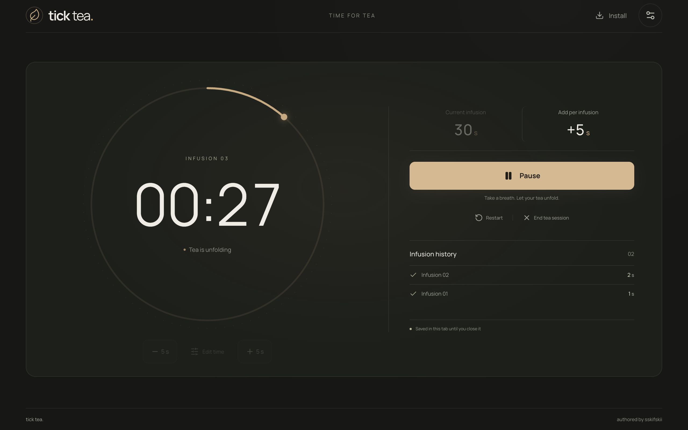

<h1 align="center">tick tea.</h1>

<p align="center">A quiet timer for your tea ritual.</p>

<p align="center">
  <a href="https://github.com/sskifskii/tick-tea/actions/workflows/deploy.yml"></a>
  <a href="LICENSE"></a>
  
</p>

A minimalist tea infusion timer. Set your starting duration and the time added to each successive infusion, then brew at your own pace. No accounts or server required.

<p align="center">
  
</p>

## Features

- Pause, resume, and fine-tune each infusion.
- Automatic time increments and history for the current tea session.
- Optional completion sound and vibration.
- Installable PWA with offline support after the first successful load and service worker installation.
- Russian and English interfaces; session restored on tab reload.

## Quick start

Requires **Node.js 22.12+** and **npm**.

```sh
git clone https://github.com/sskifskii/tick-tea.git
cd tick-tea
npm ci
npm run dev
```

## Development

Built with React, TypeScript, Vite, and Vitest.

```sh
npm test          # Run tests
npm run lint      # Check code
npm run build     # Type-check and build to dist/
npm run preview   # Preview the production build
```

Pull requests and [issues](https://github.com/sskifskii/tick-tea/issues) are welcome. See [AGENTS.md](AGENTS.md) for repository guidelines.

## Deployment

Serve `dist/` on any static host. For subpath hosting, build with:

```sh
VITE_BASE_PATH=/tick-tea/ npm run build
```

For GitHub Pages, select **GitHub Actions** in **Settings → Pages**. The included [workflow](.github/workflows/deploy.yml) checks, builds, and deploys on pushes to `main`. Offline support requires HTTPS or localhost.

## License

[MIT](LICENSE) © 2026 [sskifskii](https://github.com/sskifskii).
